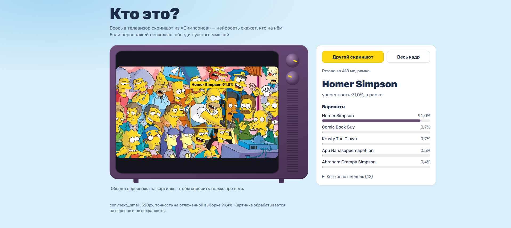
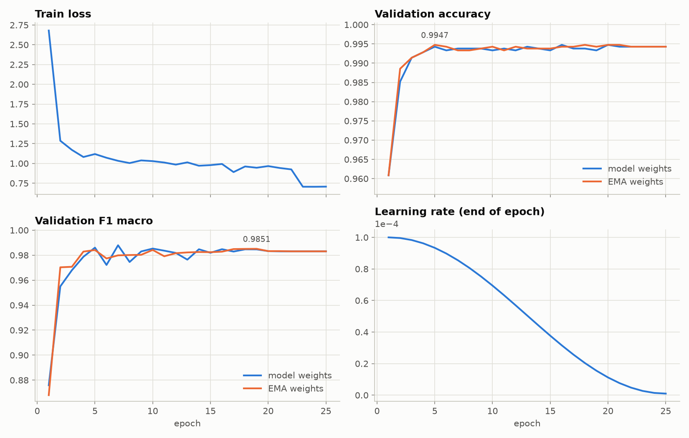
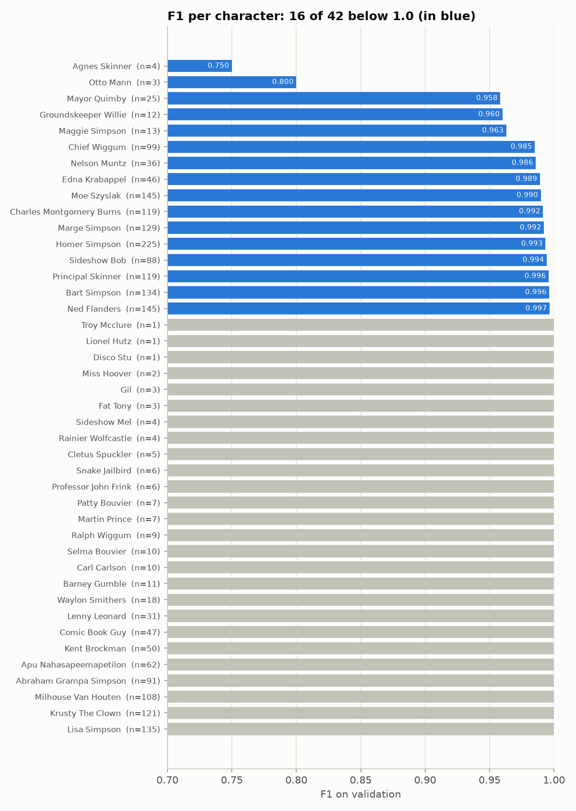
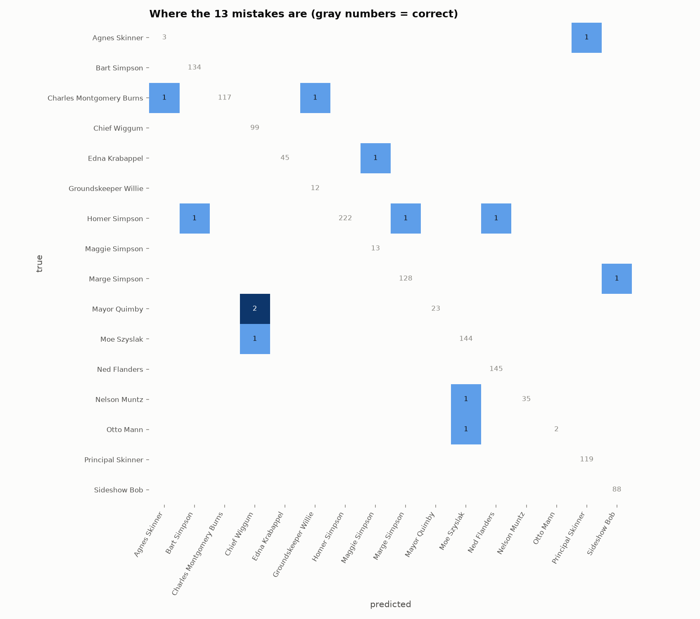

# Simpsons-who? Классификатор персонажей «Симпсонов»

Загрузи скриншот из «Симпсонов», и нейросеть скажет, кто на нём. Модель знает 42 персонажа
и набирает **F1 0.9986** на закрытом лидерборде Kaggle: около двух ошибок на тысячу картинок.



## Как запустить?

Нужен только [Docker](https://www.docker.com/products/docker-desktop/):

```bash
docker run -p 7860:7860 isequeue3000/simpsons-who
```

Открой http://localhost:7860. Работает на обычном процессоре, без видеокарты; после скачивания
образа (~0,5 ГБ) интернет не нужен. Картинки обрабатываются локально и никуда не отправляются.

<details>
<summary>Без Docker, на чистом Python 3.10+</summary>

```bash
git clone https://github.com/iseequeue/simpsons-who
cd simpsons-who/app
python -m venv .venv
source .venv/bin/activate          # Windows: .venv\Scripts\activate
pip install -r requirements.txt
python download_model.py           # модель из GitHub Releases, ~200 МБ
uvicorn server:app --port 8000     # http://localhost:8000
```
</details>

## Как пользоваться

- Перетащи скриншот в телевизор, вставь его через Ctrl+V или выбери файл.
- Широкий кадр модель просматривает по частям (слева, по центру, справа), показывает рамкой,
  где нашла персонажа, и перечисляет других, кого уверенно увидела.
- Если персонажей несколько, обведи нужного мышкой или пальцем: модель посмотрит только в рамку.
- При уверенности ниже 50% сервис честно пишет, что не уверен.

## Результаты

| Где | F1 (micro) |
|---|---|
| Kaggle «Journey to Springfield», private | **0.99855** |
| Kaggle «Journey to Springfield», public | 0.99663 |

Метрики на отложенной валидации (accuracy, F1 macro, калибровка, скорость) лежат в
[`docs/metrics.json`](docs/metrics.json), качество по каждому персонажу в [`docs/per_class.csv`](docs/per_class.csv).

| Обучение | Качество по персонажам | Где модель ошибается |
|---|---|---|
|  |  |  |

## Как это устроено

```
Kaggle: 21 тыс. кадров, 42 персонажа
   дообучение ConvNeXt-Small (ImageNet-22k) на V100, ~40 минут
   экспорт в ONNX с проверкой, что ответы совпадают с PyTorch
   FastAPI + ONNX Runtime на CPU (PyTorch не нужен)
   Docker-образ
```

Обучение: картинки 320px, AdamW с косинусным расписанием и прогревом,
Mixup/CutMix и label smoothing, более частый показ редких персонажей (у которых всего 3–30 кадров),
EMA весов, fp16, на предсказании усреднение с зеркальным отражением.

## Структура

```
classification/
  train_cls.py      обучение (timm, fp16, Mixup/CutMix, EMA)
  predict_cls.py    предсказание и сабмит для Kaggle, ансамбли
  plots_cls.py      графики и метрики
  export_onnx.py    экспорт в ONNX с проверкой
  prefetch_cls.py   скачать предобученные веса заранее (для GPU-нод без интернета)
  run_cls.sh        задача для Slurm
app/
  server.py         веб-сервис: FastAPI + ONNX Runtime
  static/           страница
  download_model.py скачать модель из GitHub Releases
  Dockerfile
docs/               графики, метрики, скриншот
```


## Ограничения

- Модель знает только 42 персонажа. Незнакомого она назовёт похожим, но обычно с низкой уверенностью.
- Обучающие кадры в основном крупные планы одного персонажа. На общих планах с толпой
  надёжнее обвести нужного героя рамкой.
